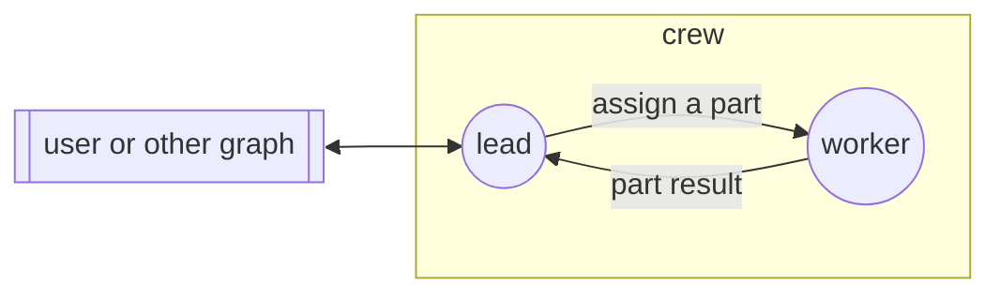

## Boundaries

- No communication with nodes outside the graph, except through `external`.
- Graph management (`/graph-up`, `/graph-down`, `/node-invite`, `/node-down`)
  is permitted with any gossip peer.
- No file changes outside the git branch of the graph.
- Reading files outside the working tree is permitted. No file changes
  outside the working tree.
- All nodes work on the same host, in the same working tree. The workers
  share one git index.

## Edges

### assign

The lead sends a part of the task to a worker. The message gives the
path of the repository, the branch, the part, and the files that the worker
can change. Each file has one owner. Shared files, such as `Cargo.toml` or a
`mod.rs`, also get one owner.

A small task can have only one part. If a part needs the result of another
part, the lead sends it after the other part is complete.

The lead also uses this edge to send a repair request or an answer to
a question of the worker.

### part-result

When a worker finishes its part, it sends the commits and a short summary to
the lead.

The worker also uses this edge to ask a question, to ask for a file that is
not its file, or to report an error in a file that is not its file.

### external

All messages from and to the user or other graphs go through the
lead. The lead gives the final result to the user.
